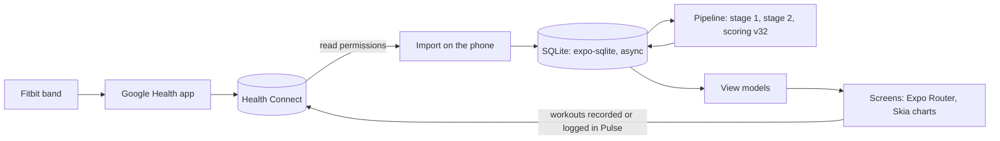
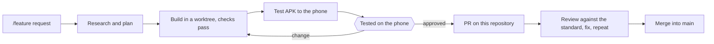

<div align="center">


# Pulse Mobile (KashyapRayas edition)

**Recovery, strain and sleep from your Fitbit, scored on your Android phone.**

No server, no account, no cloud: Pulse reads your Fitbit data from Health Connect and keeps every byte of it on the phone.
This is my own version of [Pulse Mobile](https://github.com/adityaongit/pulse-mobile): its own design, its own scoring
fixes and its own features, built and tested on my phone.

[](LICENSE)

</div>

## What's different here

| Area | Change |
|---|---|
| Design | A Linear-style look: Inter throughout, a new type scale and spacing, a new brand mark, and a round tab-bar button that opens the Coach |
| Home | **Day in review** (the morning outlook and the evening review, with the week for comparison), **metric search** with Recent and Off your usual, and **Customize Home** to hide and reorder sections |
| Workouts | **Log a past activity** by hand, from 18 sports. It's saved to Health Connect, so Google Health shows it too, and its Strain comes from the band's heart rate |
| Scoring | Scores checked against current standards (scoring version 32): Recovery reads HRV as ln(RMSSD) with each baseline's spread floored at the measure's typical error, Banister TRIMP uses the women's constant for women, max heart rate is Tanaka's, and Pulse Age no longer inflates the factors it has ([the audit](docs/standards-audit-2026-11.md)) |
| Build | A fork variant (`in.portlabs.pulse.fork`) that installs **beside** the original Pulse Mobile, with its own data and Health Connect grants |

Everything else is Pulse Mobile as it was: Sleep Performance, Recovery and Strain every morning with a Strain Target,
Pulse Age, Stress and Energy Bank through the day, Health Monitor, Journal, Trends, Reports, My Dashboard, live workouts
and the Coach with your own AI key. Each score is explained on the original's
[metrics pages](https://pulse.portlabs.in/metrics/).

## How it works



On first open, allow every Health Connect permission, including past data: Pulse imports the last 180 days. The only
thing it writes back is the exercise session of a workout you record or log in Pulse.

Builds from this repository carry no Sentry DSN, so they send no error reports. The app still checks the original
project's GitHub releases once a day for an update; Settings › App › Updates turns that off.

## Build it

Expo SDK 57 with a development build: Health Connect is a native module, so Expo Go can't run it.

```sh
git clone https://github.com/KashyapRayas/pulse-mobile.git && cd pulse-mobile
pnpm install
```

| Goal | Command |
|---|---|
| Run a development build on a phone or emulator | `pnpm android` |
| Build the installable fork APK (arm64, beside the original) | `scripts/test-apk.sh build` |
| Checks before every commit | `pnpm typecheck && pnpm lint && pnpm test` |

`scripts/test-apk.sh` needs the Android SDK and JDK 21; its header lists the defaults and how to override them.

## How features get made

Each feature goes through one Claude Code command, `/feature <request>`
([the skill](.claude/skills/feature/SKILL.md)). Only one step is manual: testing the APK on the phone.



The bar for a merge is [docs/review-standard.md](docs/review-standard.md), drawn from the project rules in
[AGENTS.md](AGENTS.md). Test APKs are published as pre-releases here and removed once their branch merges.

## Credits and license

Pulse Mobile was created by [Aditya Jindal](https://github.com/adityaongit). This repository is a fork of
[adityaongit/pulse-mobile](https://github.com/adityaongit/pulse-mobile), with scoring code ported from
[NoopApp](https://github.com/ryanbr/noop). It stays under the [PolyForm Noncommercial 1.0.0](LICENSE) license, and the
license's required notices for both are kept at the top of [LICENSE](LICENSE).
[Security](SECURITY.md) · [Code of Conduct](CODE_OF_CONDUCT.md)

<sub>An independent project, not affiliated with or endorsed by Fitbit, Google, WHOOP, Bevel, Garmin or any other wearable
maker. The code names other products only to cite what they publish.</sub>
