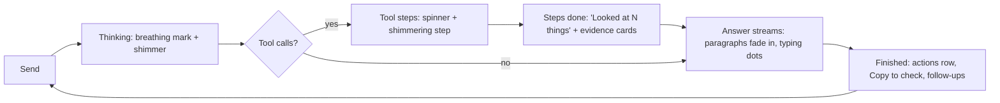

# Coach chat: a calmer, livelier conversation

Request (2026-11-28): chat features people know from Claude and ChatGPT, better loaders and input animations, chat
tools, popups that feel like the Family wallet app, references from Mobbin, all in Pulse's Linear-inspired look.

## References (Mobbin)

- **Family**, floating confirmation sheet: a card detached from the screen's edges with large corners, an icon on top,
  a centred title and line, and two pill buttons. It springs up over a dim.
  ([Refuel Gas](https://mobbin.com/screens/dd04969d-47c8-466c-a51d-6c0000b23a93))
- **Claude**, "Add to chat" sheet: a row of tiles over grouped rows
  ([sheet](https://mobbin.com/screens/58bcab7a-f050-487f-bba8-d129de43cce3)); a quiet action row under each answer
  ([answer](https://mobbin.com/screens/7f9374bd-79d3-4552-9fe0-bd26e76c94f9)); a "+" in the composer
  ([composer](https://mobbin.com/screens/0c723473-1bab-4bba-8786-10abe4b1d5a2)).
- **ChatGPT**, the composer's "+" menu of tools as a floating panel
  ([tools](https://mobbin.com/screens/4572a437-d48c-422c-adcc-c6d03d1c02ba)).

What Pulse borrows: the floating sheet (Family), the tools sheet behind "+" (Claude, ChatGPT), the grouped tool steps,
the shimmering "thinking" line, copy that turns into a check, and follow-up questions under the last answer. What it
keeps: the Linear tokens, type scale, popover material, hairlines and the coach blue. No screen copies another app.

## What the owner sees

1. **Composer.**
   - A round **+** on the left opens the tools sheet.
   - The field's border warms to the coach blue while it has focus.
   - Send springs in when there is text, and Send and Stop swap with a small zoom.
   - Near the 2,000-character limit, a "N left" counter appears.
   - Sending gives a light tap.
2. **Tools sheet** (a Family-style floating card laid out as a Linear sheet: a grabber, a left-aligned title over a
   muted line, a close circle, then one group of inset rows with hairlines). Its title is "Ask about". Six rows, each an
   icon, the topic and the question it sends, lead the coach to one tool:
   - Today
   - Last night
   - Workouts
   - Trends
   - Habits
   - Health Monitor

   A drag down, a tap on the dim or Back closes it.
3. **Thinking.** The coach mark breathes beside "Thinking…", and a soft light sweeps across the words, as in Claude and
   ChatGPT.
4. **Tool steps.** The lookups in one answer group into one line:
   - While it works, a spinner and the current step ("Reading your sleep…") shimmer.
   - When it is done, the line reads "Looked at 3 things" with a chevron. Tapping it opens the list of steps, each with
     a check, or a cross if it failed.
   - The evidence cards (rings, sleep, trends) still follow, as before.
5. **Streaming.**
   - Each new paragraph of an answer fades in.
   - Three coach-blue dots wave under the words while the answer is still coming.
   - After its lookups, while the coach works out what to say, "Thinking…" shows again under the steps.
   - Arrivals take 180 ms and springs settle in about a quarter second (owner's feedback on the first APK: snappier).
6. **Messages.**
   - A message you send rises in on a spring. Messages loaded from history do not animate.
   - Under an answer, Copy turns into a check for a moment.
   - Holding your own message opens a floating sheet with a preview and Copy and Edit, in place of the small menu.
7. **Follow-ups.** Under the latest finished answer, up to three follow-up questions fade in one after another. They are
   chosen from the lookups that answer used: after a sleep lookup, "How can I sleep better tonight?". A tap sends one.
8. **Jump to latest.** The round button zooms in and out instead of popping.
9. **Empty chat.** The mark and the starter questions rise in one after another.
10. **Errors.** The error card fades in, with the error haptic.

Reduced motion: springs, sweeps and the breathing all fall back to no animation. The shimmer and the typing dots become
static.

## Files

| File | Change |
|---|---|
| `src/screens/coach/Coach.tsx` | Composer, messages, thinking, steps, follow-ups, jump button, empty state, the user message sheet |
| `src/screens/coach/Sheet.tsx` (new) | The floating sheet: Modal, dim fade, card on a spring, pan to dismiss, header with icon, title and close |
| `src/screens/coach/Motion.tsx` (new) | `Shimmer` (a light band over text), `Spinner`, `Breathing`, `TypingDots`, the coach's quick timings (`SNAP`, `SNAP_SPRING`) |
| `src/screens/coach/ToolSteps.tsx` (new) | The grouped tool steps row |
| `src/screens/coach/ToolsSheet.tsx` (new) | The "+" tools sheet: one group of Linear inset rows |
| `src/screens/coach/Prose.tsx` | New blocks fade in while an answer streams |
| `src/coach/parts.ts` (new) + test | Groups a message's parts into text and tool-step runs. Pure |
| `src/coach/followUps.ts` (new) + test | Follow-up keys from the tools an answer used. Pure |
| `src/i18n/locales/*/coach.json` | New keys in all eight languages |
| `docs/learning.md` | Layout animations and the gesture sheet |

The new pieces stay in `src/screens/coach`, so the kit's exports (`src/ui`) do not change. If the owner wants the
floating sheet elsewhere later, it moves into the kit as its own change.

## Data, scoring, rules

- No Store, scoring, import or Health Connect change. No `SCORING_VERSION` or `IMPORT_VERSION` bump.
- No new network call: the tools sheet and follow-ups only send a chat message, as typing it would.
- No new dependency. Reanimated 4.5, Gesture Handler 2.32, expo-linear-gradient and expo-haptics are already in the app.
- Telemetry and the coach's transport are unchanged.

## Out of scope

- Voice input, attachments and images: the coach reads Pulse's data, not files.
- Thumbs up and down: there is nowhere to send feedback.
- Model switching in the composer: it stays in Coach settings.
- The floating sheet outside the coach.

## Phone checks

1. Open Coach on an empty chat. The mark and suggestions rise in.
2. Type in the composer. The border turns blue, and Send springs in. Clear the text, and Send fades back.
3. Tap **+**. The tools sheet floats up with six rows in one group. Drag it down, and it closes. Open it again and tap **Last night**. The question
   sends.
4. While it answers: the breathing mark and the shimmering "Thinking…", then a spinner with the shimmering step, then
   "Looked at N things". Tap it, and the steps open with checks.
5. The answer's paragraphs fade in, with three waving dots under them until it finishes. Tap **Stop** mid-answer, and Send returns.
6. When it finishes, follow-up questions appear. Tap one, and it sends.
7. Tap Copy under an answer. The icon turns into a check.
8. Hold your own message. The floating sheet opens with Copy and Edit. Edit still works.
9. Scroll up during a long answer. The jump button zooms in. Tap it, and it zooms out.
10. With Remove animations on (Android accessibility), nothing sweeps or springs, and everything still works.
11. Turn airplane mode on and send. The error card fades in with a buzz, and Retry works.
