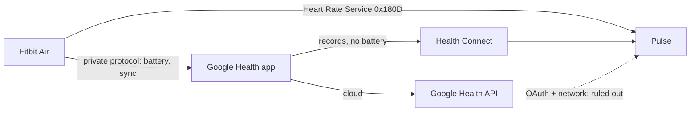

# Fitbit Air battery in Pulse

Request: show the connected Fitbit Air's battery level in the app, the way the Google Health app does.

Status: the owner chose option 1, the band status card (below).

## Where a battery level could come from

| Source | Gives a number? | Fits AGENTS.md? |
|---|---|---|
| Health Connect | No. There is no battery record type; record metadata names the device, not its charge. | Yes |
| Bluetooth Battery Service (0x180F / 0x2A19) over Pulse's existing BLE link | No. The Fitbit Air does not offer it: its GATT services are 1800, 1801, 180a, fd00, ff00, 0045, 180d and 1c00 (`docs/workout-tracker/whoop-ui.md`). | Yes |
| Android's own Bluetooth battery (`BluetoothDevice.getBatteryLevel`) | No. It is a system API (`BLUETOOTH_PRIVILEGED`), and Android only knows it for devices with the Battery Service or HFP. | n/a |
| Fitbit's own services (fd00, ff00, 1c00) | Maybe, but it's Fitbit's private, authenticated protocol with Google Health holding the keys. Not a path. | n/a |
| Legacy Fitbit Web API `GET /devices.json` (`batteryLevel`) | Yes, but it shuts down in autumn 2026. | No: network source and Google OAuth |
| Google Health API (the Web API's successor) | Unconfirmed: its docs list data bundles, with no battery field found. | No: network source and Google OAuth |

Google Health reads the battery level over Fitbit's private Bluetooth protocol. Pulse can't use that protocol.

## Options

1. **Band status card, no number (recommended, chosen).** Settings › Live heart rate's band card shows what Pulse
   truly knows: how old the newest heart rate is, and a warning when the band has gone quiet. A button opens Google
   Health, which shows the level. No new permission, no network, no fabricated number.
2. **Cloud battery.** Sign in with Google and call the Google Health API for the device's battery, if it exposes one.
   This breaks two rules: no Google sign-in and no network source. It needs a Google Cloud project with OAuth set up,
   and it's still unconfirmed that the API returns battery at all.
3. **Low-battery alerts from Google Health's notifications.** A notification-access permission lets Pulse read
   Google Health's "battery low" notification. That only gives a low/not-low signal, and the permission lets Pulse read
   every notification on the phone.

## What gets built (option 1)

The owner opens Settings › Live heart rate. The band card gains:

- **Latest heart rate**: how long ago the newest stored heart-rate sample was ("12 minutes ago", or "None yet").
- **Battery: Shown in Google Health**, and a **Check battery in Google Health** button that opens Google Health.
- A warning, *Nothing new from the band for hours…*, when the last import ran 3 hours or more after the newest
  sample, and the band isn't live over Bluetooth at that moment. A sync that simply hasn't run yet never triggers
  it, so the band isn't blamed for Pulse's own delay.

Files:

- `src/queries/bandExtras.ts` (+ test): `getBandFreshness`, built on `Store.hrBounds()`. It's Pulse-only, so it
  lives in its own `*Extras` file.
- `src/screens/settings/LiveHeartRate.tsx`: the rows, the warning and the button. The button reuses `openApp` from
  `modules/pulse-bt`.
- `src/i18n/locales/*/settings.json`: six `live.*` keys in all eight languages.

There are no data or scoring effects: no `SCORING_VERSION` or `IMPORT_VERSION` bump, no Store change, no new
permission, no network call and no native change.

Out of scope: a battery percentage. No legitimate source gives Pulse one (see the table).

## Phone checks

1. Settings › Live heart rate: the band card shows "Latest heart rate" with a recent time, and "Battery: Shown in
   Google Health".
2. Tap "Check battery in Google Health": Google Health opens, and its Fitbit Air page shows the battery.
3. With the band charging or off the wrist for 3+ hours, then a sync: the card shows the "Nothing new from the
   band" warning. Wear the band again, sync, and the warning goes away.
4. Go live: while the link is live, no warning shows.
