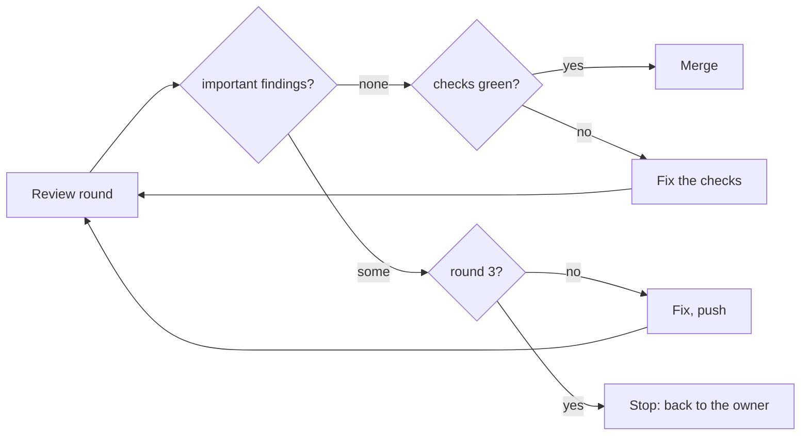

# Review standard

The bar a pull request clears before it merges into the fork's `main`. The `/feature` workflow
(`.claude/skills/feature/SKILL.md`) reviews every PR against it, fixes what it finds and reviews again. Humans reviewing
by hand use the same list. Every rule here comes from `AGENTS.md`; when the two disagree, `AGENTS.md` wins and this file
is out of date.

## When a PR is clean

A PR passes when one review round reports **no `important` finding** and every check below is green.

| Severity | Meaning | Blocks the merge |
|---|---|---|
| `important` | A bug the change adds or makes worse, or a broken rule from the list below marked **blocking** | Yes |
| `pre_existing` | A bug that was there before the change | No: note it in the PR, or fix it if it is one line |
| `nit` | A minor issue or a non-blocking rule | No: fix it when it is cheap, else leave it |

The loop runs at most **3 rounds**. A PR that still has an `important` finding after the third stops and goes back to
the owner with the findings, instead of looping.



## Checks (blocking)

Each runs from the repository root and must pass on the PR's head:

```sh
pnpm typecheck
pnpm lint            # 0 errors; warnings already on main do not block
pnpm test
npx expo export --platform android --output-dir "$TMPDIR/pulse-bundle-check"   # then delete the folder
```

The bundle check is required when the PR touches `babel.config.js`, `metro.config.js`, `app.json`, `app.config.js`,
`package.json` or adds a route, and cheap enough to run every time.

## Rules

**Blocking** rules make a finding `important`. The rest are `nit`.

### Data and scoring

- **Honest states (blocking).** Every nullable metric is `{ value, reason, provisional }` with a reason code from
  `src/lib/reasons.ts`. No fabricated number: a card without data hides or shows its reason. Averages and comparisons
  use the same gating as the value they sit beside.
- **Causality (blocking).** A day's scores depend only on that day and earlier days. Baselines fold from earlier
  nights. Nothing lets a later night change history.
- **Version bumps (blocking).** A change to what the pipeline stores bumps `SCORING_VERSION`
  (`src/pipeline/types.ts`), with the parity hashes in `src/pipeline/pipeline.test.ts` updated and commented. A change
  to the import mapping bumps `IMPORT_VERSION` (`src/health/sync.ts`).
- **Scales (blocking).** Strain is a percent (0 to about 129), Recovery 1 to 100, Stress and Sleep Performance 0 to 100,
  Energy Bank 1 to 100, Recovery's `sleepPerf` on [0, 1].
- **Reference code.** `src/core/engine` follows the reference study (cited as "reference study, `<doc>.md` §
  `<section>`", never naming the app it describes). `src/health`, `src/data`, `src/pipeline`, `src/queries` follow halo;
  Pulse-only additions live in their own `*Extras.ts` files.

### Architecture

- **Only `src/data` touches SQLite (blocking).** Everything else goes through the `Store` interface.
- **No I/O in `src/core` (blocking).** No database, network, clock reads or React.
- **Health Connect writes (blocking).** Pulse writes only exercise sessions of workouts recorded or logged in Pulse
  (`saveExercise`). Any other write type needs the owner's approval first.
- **No native edits (blocking).** `android/` is generated. Native behaviour goes in `app.json`, `app.config.js`, config
  plugins or `modules/`.
- **Long loops yield.** Import and pipeline loops await `slice()` (`src/lib/yield.ts`).
- **Shared files.** The `Store` interface, the UI tokens and the kit's exports change only with the owner's say-so.

### Privacy and telemetry

- **No secrets or health data in logs (blocking).** No record bodies, keys, URLs, model ids or free text in logs or
  telemetry tags.
- **Telemetry codes.** Each `report` or `reportError` call has a stable dotted code, listed in `docs/telemetry.md`, with
  tags that are enums or small counts. One failure reports once.
- **No accounts.** No login, no user ids, no Google account details stored.

### UI and copy

- **i18n (blocking).** User-facing text goes through i18n keys (`docs/i18n.md`); `pnpm lint` flags literals in JSX. Keys
  removed from English are removed from every locale.
- **Names.** Pulse, Pulse Age, Health Connect; WHOOP's names where the study and WHOOP differ (Sleep Performance, Sleep
  Debt, Sleep Need, Strain Target, Training Load, Stress Monitor).
- **Look.** Built from `src/ui` shells and kit with NativeWind classes and the tokens. A screen needing a changed view
  model adapts its code, not its look.
- **Expo APIs** match SDK 57's docs (`https://docs.expo.dev/versions/v57.0.0/`), not memory.

### Tests and docs

- **Tests beside the change.** Algorithms get golden-value or property tests; queries and actions get tests on
  `MemoryStore`. A fixed bug gets a test that fails without the fix.
- **Docs.** A new Expo or React Native choice adds a short section to `docs/learning.md`. Flows use mermaid.

### Git

- Conventional commit messages, signed off (`git commit -s`), as `KashyapRayas <kashyap.rayas@gmail.com>`.
- Never force-push. PRs and merges go to the fork, `KashyapRayas/pulse-mobile`, never to upstream.
